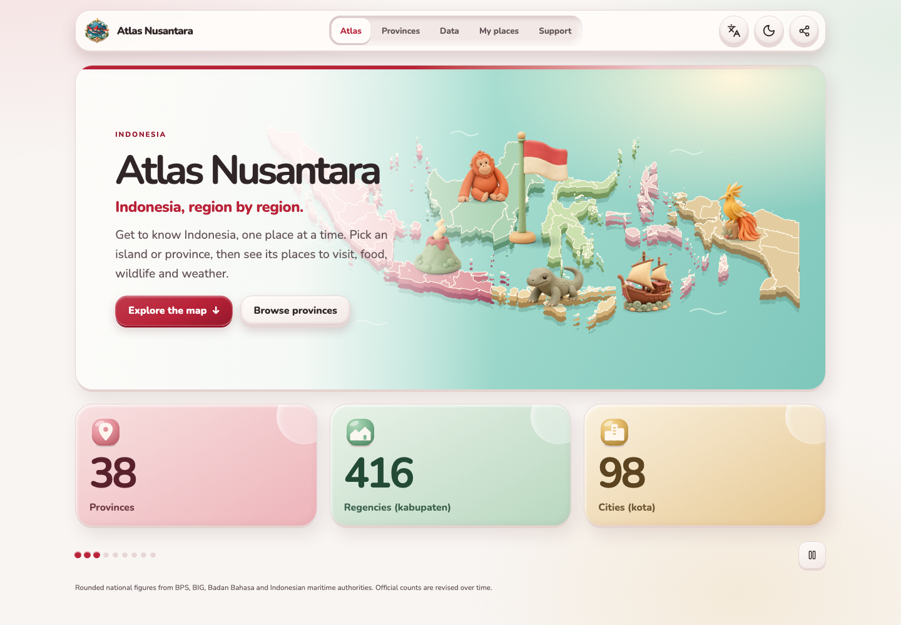
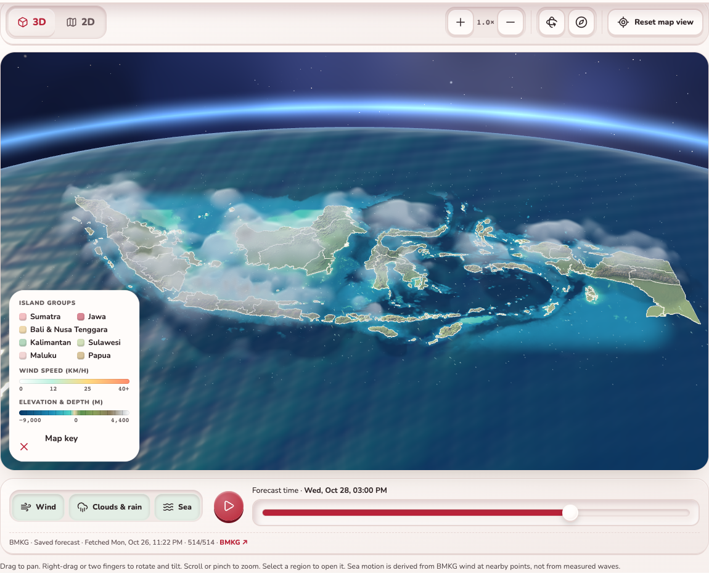
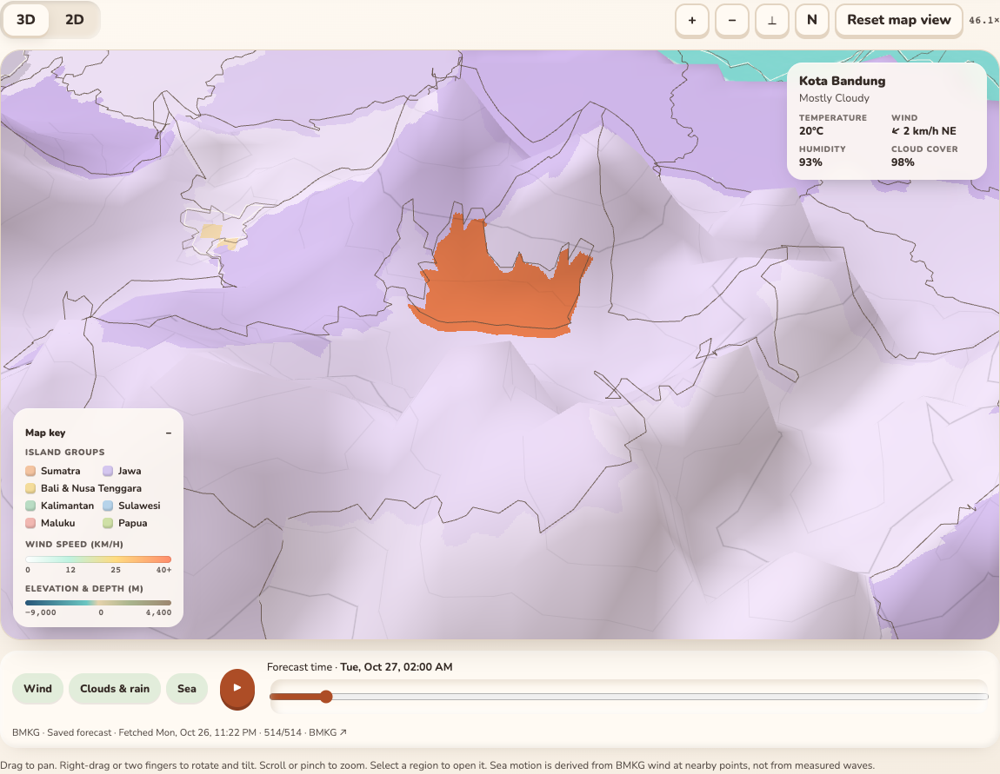
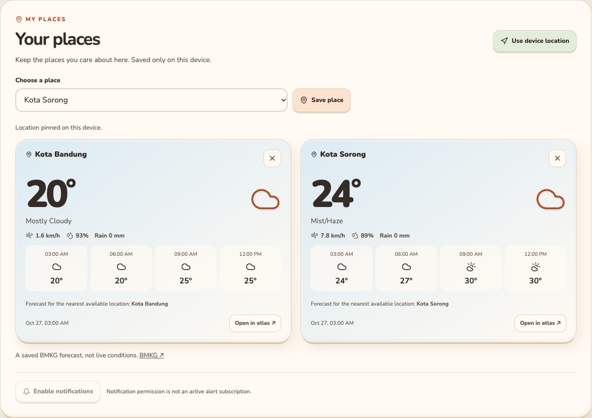

# Atlas Nusantara

Atlas Nusantara brings information about Indonesia together—from provinces and cities to landscapes, destinations, culture and changing conditions. Explore the map, browse source-backed data layers and compare what different sources tell us. Prepared for **https://nusantara.readynaz.com** on Cloudflare Workers.

**Not an emergency alert service.** Forecasts and earthquake records are dated snapshots. Missing data never means an all-clear.



| Explore the archipelago | A closer look | Your places |
|---|---|---|
|  |  |  |

## What works

- **38 provinces / 514 cities and regencies:** searchable directory, sortable table and city links all drive the same map selection.
- **Real source-derived geography:** OCHA/BPS coastlines and boundaries, NOAA ETOPO1 terrain and bathymetry, pan/scroll/pinch zoom, tilt and north controls, plus an accessible SVG fallback.
- **Information across Indonesia:** browse dated BMKG weather and earthquake snapshots, a BIG named-mountain inventory, and 18,596 source-linked SISPARNAS destinations across 38 provinces, including 241 records with verified, credited Commons image links. Layers have their own sources, limits, legends and map pins.
- **Private weather cards:** saved places and rounded device location stay in localStorage. Language popup with flags, mobile quick settings, light/dark transitions and reduced-motion support.
- **Mobile installation and recovery:** install invitation only on uninstalled mobile web; consent-based updates, illustrated HTTP 404 and runtime error views, independent 500/503 HTML fallbacks, Terms and Privacy pages.

The atlas combines independent datasets; availability and coverage vary by layer, and the layers do not represent a complete inventory of Indonesia. The destination catalog contains 18,596 unique records returned by the public SISPARNAS API, versus its 18,982 national aggregate. Categories absent from individual records stay unclassified; invalid or out-of-province coordinates are omitted, not relocated. The mountain layer is a named-feature inventory, not every summit. The map is simplified, not survey-grade or a legal border reference. Cloud altitude and wave motion are visual models, not satellite clouds or measured waves. Disaster reports merge BNPB official records, PetaBencana.id citizen reports and ANTARA/GDELT headlines through a cleaning [pipeline](docs/HAZARD_PIPELINE.md); they are unverified or preliminary and never an official warning. InaRISK hazard polygons are not connected. See [source evidence and limitations](docs/DATA_SOURCES.md).

## Run and verify

Node 22.12+:

```sh
npm ci
npx playwright install chromium webkit
npm run dev
```

```sh
npm run check:locales
npm run check
npm run worker:check
npm test
npm run test:browser
npm run test:worker
npm run worker:dry-run
```

The Worker integration uses isolated **local** workerd/D1/R2 resources and synthetic fixtures. It does not call providers, activate live push or modify remote resources.

Dependency audit: three low-severity SvelteKit 2 / `cookie` findings remain; the supported fixes require framework/adapter major upgrades. Compatible tooling updates cleared the high/moderate findings. Review the remaining chain before enabling server-rendered routes.

## Refresh snapshots

**Indonesian cuisine:** A static cuisine layer at `/?layer=cuisine`, built like flora and fauna: 2,164 dishes from the Indonesian Wikipedia list with 3,667 recipes (Cookpad Indonesia, an MIT corpus and four reviewed seeds) for 1,335 of them, Wikipedia summaries and 1,406 dishes with linked, credited photos, in 38 province shards. Search covers dish names and ingredients. Photos and recipes stay with their sources and are linked, never copied. Recipe text is Indonesian until translated. See [CUISINE.md](docs/CUISINE.md).

**Destinations are static and manually maintained:** 38 province JSON files plus a complete `national.json` download. The atlas opens on the Weather layer in the national view; the Destinations layer starts national too, and `?region=` links open a province. Each province has a searchable, filterable, sortable table with client-side pagination. No destination API or scheduled worker is needed. After editing source JSON, run `npm run build:destinations` offline; see [destination maintenance](docs/DESTINATIONS.md).

Browsers do not call BMKG for the map or saved-place cards. These scripts fetch dated assets deliberately:

```sh
node scripts/ingestion/forecast-snapshot.mjs
node scripts/ingestion/earthquake-snapshot.mjs
```

Scheduled refreshes are defined for **weather every 3 hours** and **earthquakes every 25 minutes**. Collection/publishing requires repository flags and the intended CDN credentials; it has not been activated remotely. See [SNAPSHOT_REFRESH.md](docs/SNAPSHOT_REFRESH.md).

Forecast capture takes about 10 minutes at under 60 requests/minute. It verifies provider code/name pairs, reports missing points and retains the previous file if fewer than 90% succeed. Captured data remains dated when offline; it is never labeled live.

Administrative codes follow the pinned 2025 transcription. See [DATA_SOURCES.md](docs/DATA_SOURCES.md) for its checksum, upstream header discrepancy and explicit BMKG crosswalk. Rebuilding geometry and relief is documented in [GEOMETRY.md](docs/GEOMETRY.md).

## Cloudflare and extensions

`npm run data:bootstrap` builds and seeds the local 552-row hierarchy. Source approval gates for the scheduled D1/R2 publication pipeline remain separate from the checked-in snapshots. Review [CLOUDFLARE.md](docs/CLOUDFLARE.md) before deployment; remote resources and source approvals are not configured by a commit.

Add mountain, volcano or landmark points through the typed [overlay contract](docs/OVERLAYS.md), not by editing the base-map renderer.

Design, assets and screenshots: [DESIGN.md](docs/DESIGN.md), [ASSETS.md](docs/ASSETS.md). Other guides: [architecture](docs/ARCHITECTURE.md), [ingestion](docs/INGESTION.md), [PWA](docs/PWA.md), [localization](docs/I18N.md), [sharing](docs/SHARING.md), [BMKG CAP](docs/BMKG_CAP.md), [hazard pipeline](docs/HAZARD_PIPELINE.md), [optional push prototype](docs/PUSH.md).

Human translation review, authoritative 2025 boundary certification, BNPB/InaRISK adapters and reuse review, live source activation, browser push delivery and native-device testing remain release work.
