# Atlas Nusantara: design and interaction

## Direction

A clay atlas you can take apart: start with Indonesia, choose a province, then a city. The map, breadcrumb, weather panel, table highlight and saved-place action follow one region selection. The interaction is an anatomy of the country, not a series of unrelated dashboard boxes.

The trick-it reference supplied high-level behaviour: a compact clay header, language selection with flags, mobile settings, source transparency and useful error recovery. Atlas Nusantara uses its own mark, illustrations and geography; reference artwork and identity were not copied.

The visual identity follows *Merah Putih*: flag-inspired crimson on porcelain white, supported by quiet foliage green and brass-gold. Pale rose, leaf and champagne washes blend the colors across the hero, cards and control wells without making every button a primary action. Both themes retain shallow extruded clay edges, restrained inset highlights and readable text/focus contrast. Seven related red/green/gold shades distinguish island groups; labels and geometry remain the primary identifiers. Weather, relief and emergency severity keep independent meaningful data colors instead of being recolored for branding. Nunito is self-hosted.

## Page and shared state

- **Header:** Atlas Nusantara on desktop, Nusantara on mobile. Desktop language popup lists 13 flagged native-language choices. Mobile quick settings groups language, share and theme. Theme changes reveal from the activated control, with a direct reduced-motion fallback.
- **Atlas:** full-width source-derived map, a compact layer strip, shared breadcrumb and a searchable region-card directory. Buttons, keyboard, wheel, drag and touch pinch are alternatives. The map key collapses on phones so it does not cover the islands.
- **Charts and table:** island-group stacked bars and the kabupaten/kota ring expose their values accessibly. The table sorts, filters and highlights the selected province; province and city links open the same map rather than a disconnected view.
- **Your places:** rounded device location and saved regions live only in localStorage. Each card shows a dated nearby BMKG sample, temperature, weather, wind, humidity and upcoming forecast steps. It does not pretend a single village represents an entire province.
- **Secondary information:** edition and detailed sources belong in Terms. No roadmap section. Installation appears only on uninstalled mobile web; update consent remains available when needed. Errors provide recovery links and safe references.

## Motion and skills

All skills under the project’s skill directory were considered. The relevant practices are applied together, not as unrelated features:

| Skill | Application |
|---|---|
| ui-ux-pro-max | Clay tokens, typography, chart semantics, contrast, responsive layouts and keyboard/touch controls |
| build-awwwards-quality-sites | Original hero imagery, restrained GSAP sequencing, one Lenis page-scroll engine and deliberate fallback states |
| scroll-world-storytelling | A Three.js world with a broad-to-specific camera journey; map wheel/pinch input zooms through a visual cloud deck |
| anatomy | One model supplies the geometry, relief, readouts and interaction; deliberate depth and legible controls explain the country |
| algorithmic-art | Reproducible seeded particle placement and flow advection through actual forecast fields |
| imagegen | Original clay hero, legal, offline and error illustrations, compressed to responsive WebP assets |

The HTML-demo workflow was reviewed but is not used to fake an interactive product recording: this is the actual working app. No p5 canvas, second scroll engine, fabricated weather or simulated geographic tiles are added merely to exercise a skill.

GSAP owns hero/heading choreography; Lenis excludes the map, dialogs, table and directory. MapControls owns the map camera. Weather has one scene clock, bounded pixel ratio, offscreen/hidden pause and complete teardown. Reduced motion freezes ambient effects and skips smooth page scrolling, cloud penetration and camera interpolation.

Cloud opacity follows forecast coverage. The camera-crossing veil is a presentation effect at an illustrative cloud height, not measured atmospheric volume. See [GEOMETRY.md](GEOMETRY.md) for the physical-data limitations.

## Screenshots

The checked-in screenshots document the earlier palette and should be regenerated after this design update.

Run `npm run build`, `node scripts/serve-built.mjs`, then `node scripts/capture-screenshots.mjs`. Images are actual production-build captures at 1440 × 1000 and 390 × 844, with reduced-motion static frames. Saved-place images use public city pins, not a private device location.

| Home | Theme |
|---|---|
|  | 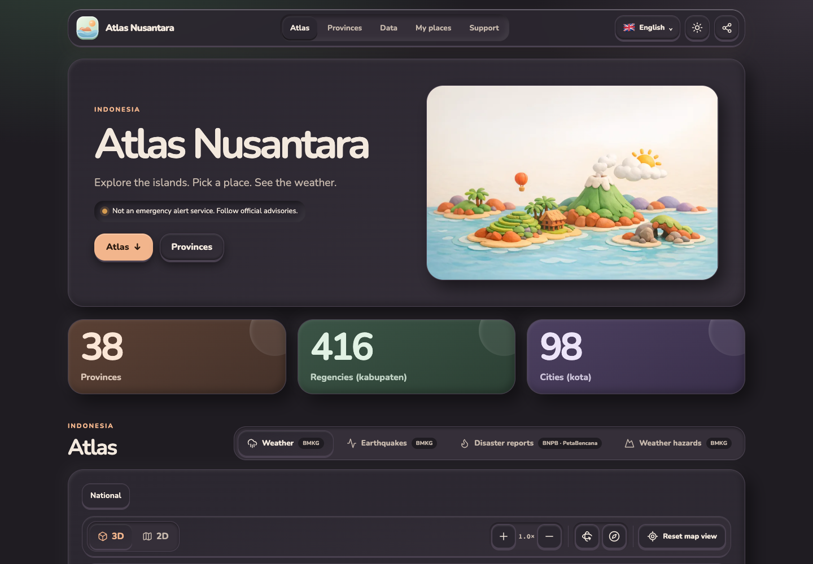 |

| Indonesia | Province |
|---|---|
|  | 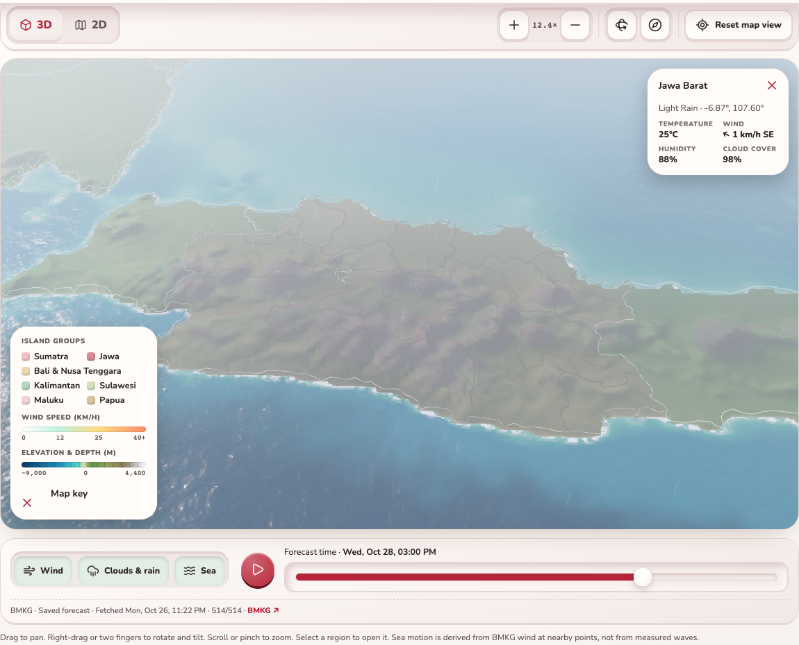 |

The 3D map is a small world in space: a starfield with an atmospheric limb, a Gerstner-wave ocean (turquoise shallows to navy deep, sun glitter, foam; motion derived from BMKG wind, not measured waves), hillshaded ETOPO1 land with hypsometric tint and contour lines, ray-marched clouds with shadows, wind streamlines and rain. Controls are grouped icon buttons (view, zoom, orientation, reset), a bottom dock for layers and the forecast clock, and a collapsible map key.

| City weather | Another overlay |
|---|---|
|  | 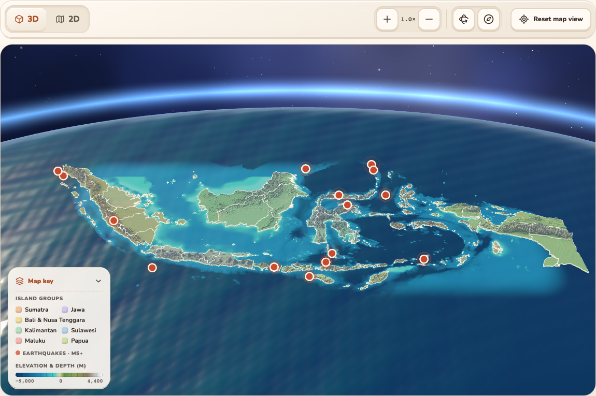 |

| Directory | Details |
|---|---|
| 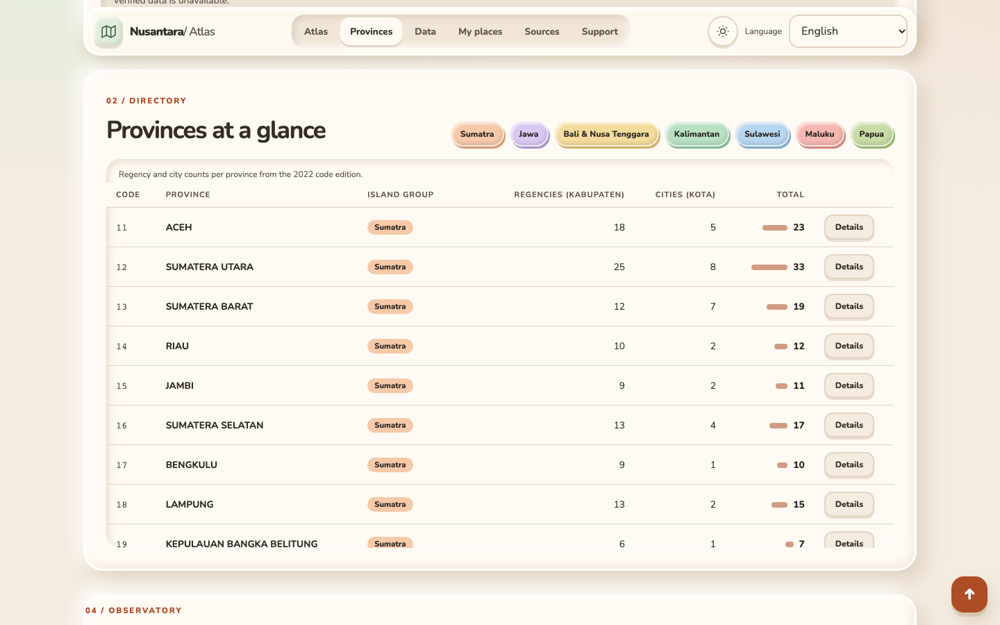 | 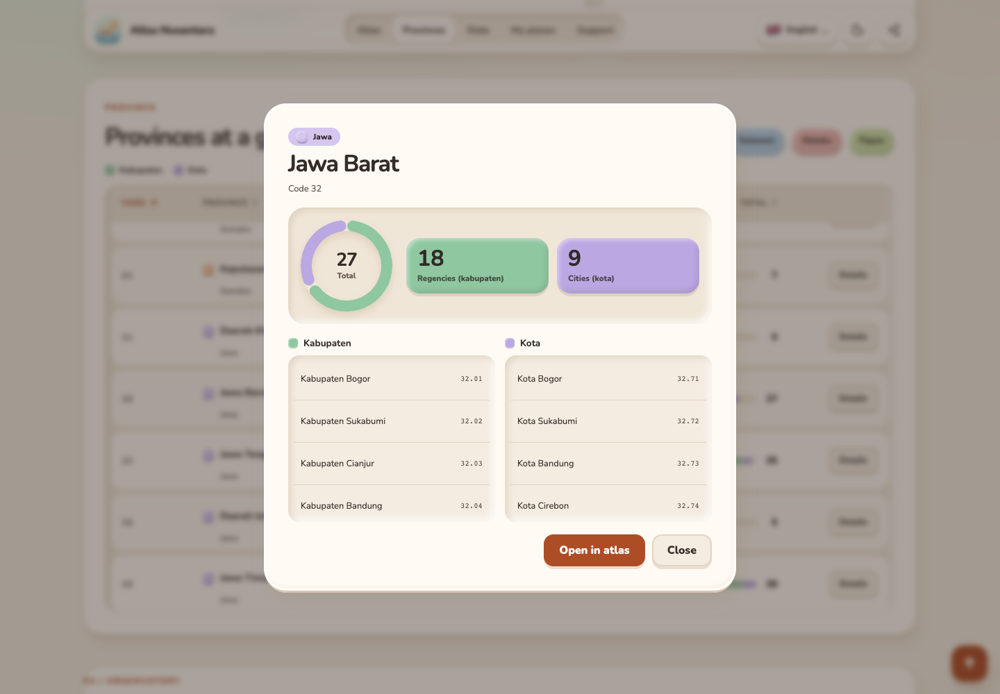 |


Saved places are claymorphic cards with an animated scene per forecast code (sun, moon and stars at night, drifting clouds, rain, lightning, mist). Animation pauses off-screen and under reduced motion.

| Disaster reports | Weather hazards |
|---|---|
| 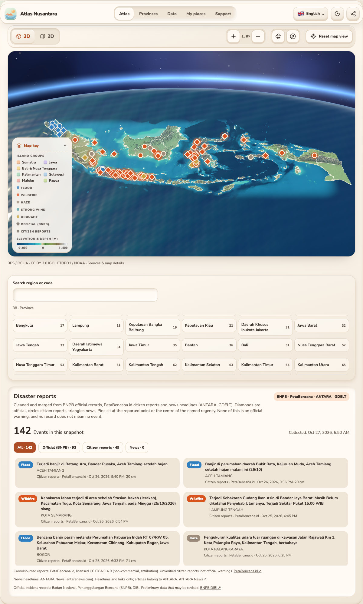 | 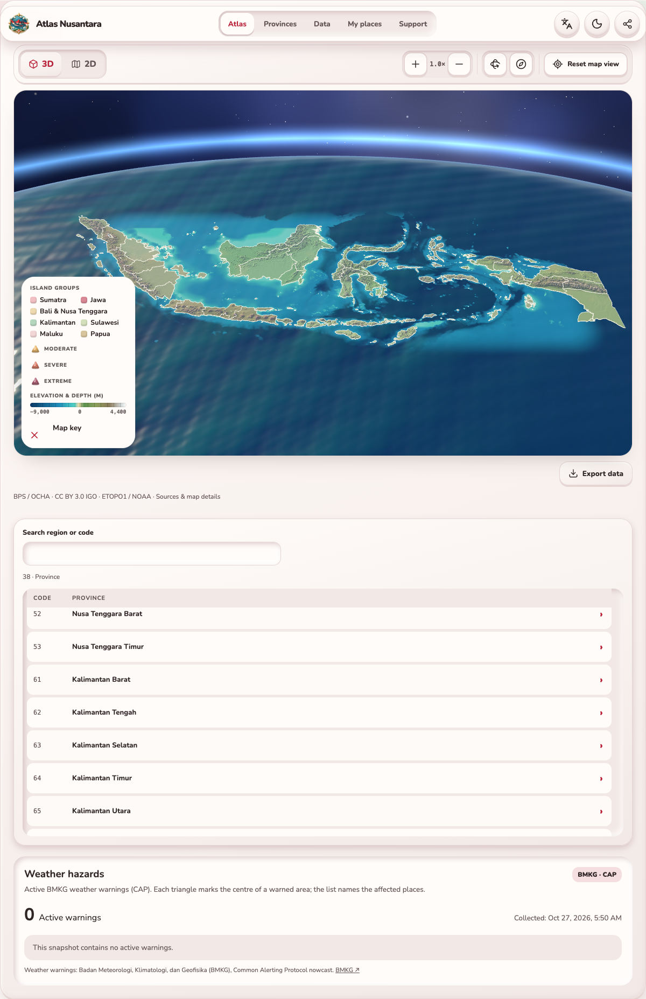 |

| Mobile home | Mobile controls |
|---|---|
| 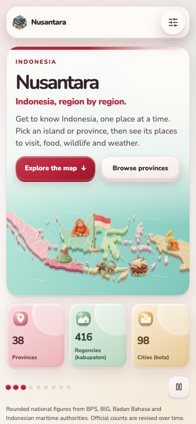 | 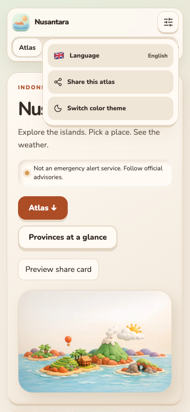 |

| Languages | Mobile atlas |
|---|---|
| 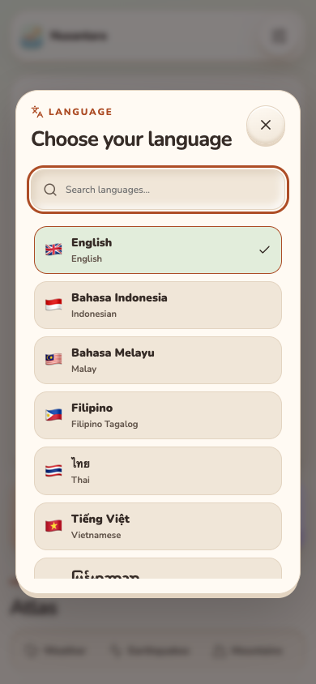 | 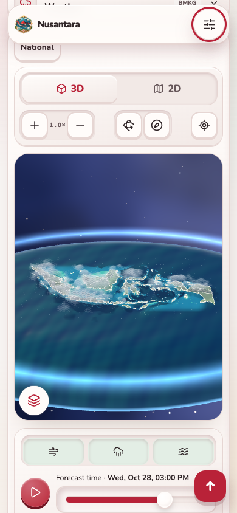 |

| Recovery | Terms |
|---|---|
| 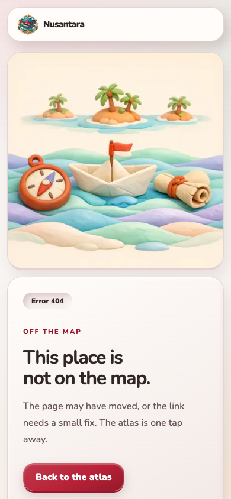 | 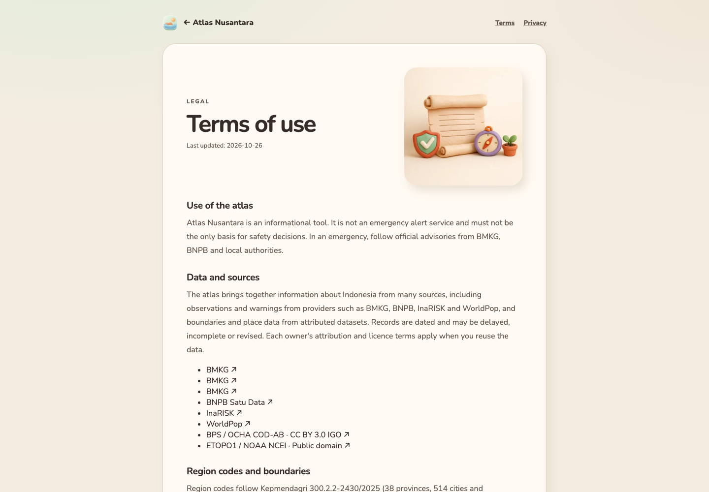 |

## Support and source

Support is voluntary and separate from data authority: Trakteer `yunaz_gilang`, Ko-fi `ygrip`, Patreon `ygrip`, and https://readynaz.com, matching the reference maker's published links. Source code links to https://github.com/ygrip/nusantara. Neither contributions nor advertisements affect warning priority.

## Optional sponsor slot

Advertising is **off by default**. For a clearly labeled first-party text sponsor slot set these public build-time variables, then rebuild:

```
VITE_SPONSOR_ENABLED=true
VITE_SPONSOR_TITLE=Your reviewed sponsor name
VITE_SPONSOR_URL=https://your-approved-sponsor.example
```

Only a validated HTTPS external link is rendered. No advertising network, image pixel, iframe, script, cookie, auction or third-party request loads before clicking it. `rel="sponsored noopener noreferrer"` identifies the paid link. This is preparation, not an AdSense integration or publisher approval. Before adding a network provider, obtain publisher approval, add the required privacy/consent flow and region-specific compliance, review CSP, and supply its actual authorized `ads.txt` entries. No fabricated publisher ID is shipped.
