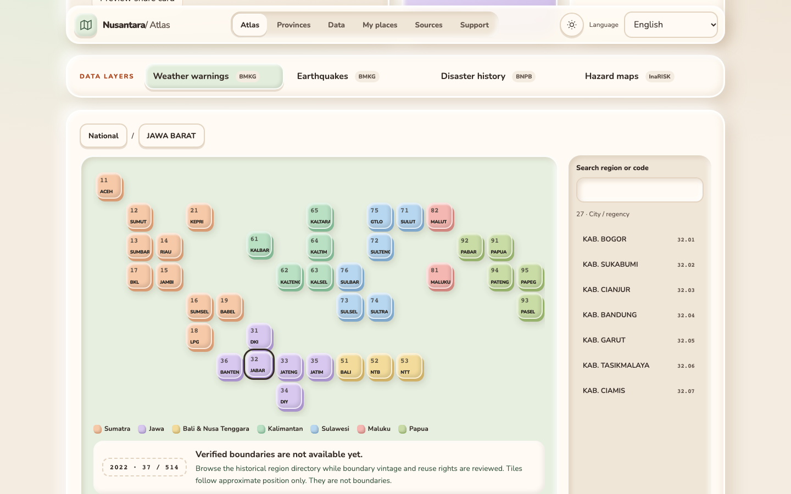

# Visual and monetization direction

Reference: https://tools.readynaz.com (trick-it), inspected alongside the maker's local `open-tools` repository. Reused high-level principles: warm cream, brown type, pastel raised surfaces, generous rounded corners, Nunito and quiet interaction. Nusantara retains its own atlas identity, mark, palette accents and data graphics; no reference illustration, avatar or platform logo was copied.

Nunito is self-hosted via `@fontsource-variable/nunito` under the SIL Open Font License included with that package. System fonts cover scripts absent from Nunito. SVG geography is generated only from reviewed source inputs, not drawn by an image model. No image generation credits, WebGL, p5 rendering, scroll hijacking, GSAP or continuous decorative animation is needed for a lightweight working atlas.

## Claymorphic bento layout

The page uses a claymorphic system defined as CSS tokens in `src/app.css`: warm cream and pastel surfaces, 24–28 px radii, paired outer drop shadow plus inner highlight/shade (`--clay-shadow`), pressed insets for inputs and selected states (`--clay-pressed`), and a short `cubic-bezier(.34,1.56,.64,1)` press/hover bounce. Light and dark themes share the same tokens. `prefers-reduced-motion: reduce` removes every transition and animation.

Layout, top to bottom:

1. **Sticky section navigation** — a clay pill with Atlas · Provinces · Data · My places · Sources · Support. The section in view is highlighted (`IntersectionObserver`, `aria-current="location"`). A skip link jumps to the atlas; a back-to-top button appears after the hero scrolls away. On phones the navigation becomes a second, horizontally scrollable chip row.
2. **Hero bento** — title card with primary actions and share preview, three edition stat cards (37 provinces, 416 kabupaten, 98 kota, verified by the region import) and the code-edition card.
3. **Data layers bar** — the four layer toggles in one horizontal clay bar directly above the map.
4. **Atlas card** — breadcrumb, map and the searchable directory. With verified geometry the SVG map (zoom, pan, pinch) renders; without it, the schematic province tile map renders (see [GEOMETRY.md](GEOMETRY.md)).
5. **Province table** — 37 rows with island-group filter chips, kabupaten/kota/total columns, and a **Details** popup (native `<dialog>`, focus-trapped, Escape/backdrop to close) listing every city/regency, with **Open in atlas** that selects the province and scrolls back to the map.
6. Observatory summary, preferred locations, install, sources/roadmap bento and support.

Navigation paths stay short: tile or directory → province → city; table → popup → atlas. Every control is a native button or link with a visible focus ring and at least a 36–44 px target. No GSAP, smooth-scroll engine or WebGL was added; skills consulted were `ui-ux-pro-max` (claymorphism style, bento/dashboard guidance, pre-delivery checklist) and `build-awwwards-quality-sites` (static first frame, reduced motion, no ornamental motion). The isometric `anatomy` skill was evaluated and not used, because the atlas must not imply geography that the data cannot support.

## Screenshots

Captured from the production build (`npm run build`, `node scripts/serve-built.mjs`) with Playwright at 1440 × 900 and 390 × 844. No provider data is configured locally, so the observatory shows its honest unavailable state.

| | |
|---|---|
|  |  |
|  |  |
|  |  |


## Support and source

Support is voluntary and separate from data authority: Trakteer `yunaz_gilang`, Ko-fi `ygrip`, Patreon `ygrip`, and https://readynaz.com, matching the reference maker's published links. Source code links to https://github.com/ygrip/nusantara. Neither contributions nor advertisements affect warning priority.

## Optional sponsor slot

Advertising is **off by default**. For a clearly labeled first-party text sponsor slot set these public build-time variables, then rebuild:

```
VITE_SPONSOR_ENABLED=true
VITE_SPONSOR_TITLE=Your reviewed sponsor name
VITE_SPONSOR_URL=https://your-approved-sponsor.example
```

Only a validated HTTPS external link is rendered. No advertising network, image pixel, iframe, script, cookie, auction or third-party request loads before clicking it. `rel="sponsored noopener noreferrer"` identifies the paid link. This is preparation, not an AdSense integration or publisher approval. Before adding a network provider, obtain publisher approval, add the required privacy/consent flow and region-specific compliance, review CSP, and supply its actual authorized `ads.txt` entries. No fabricated publisher ID is shipped.
